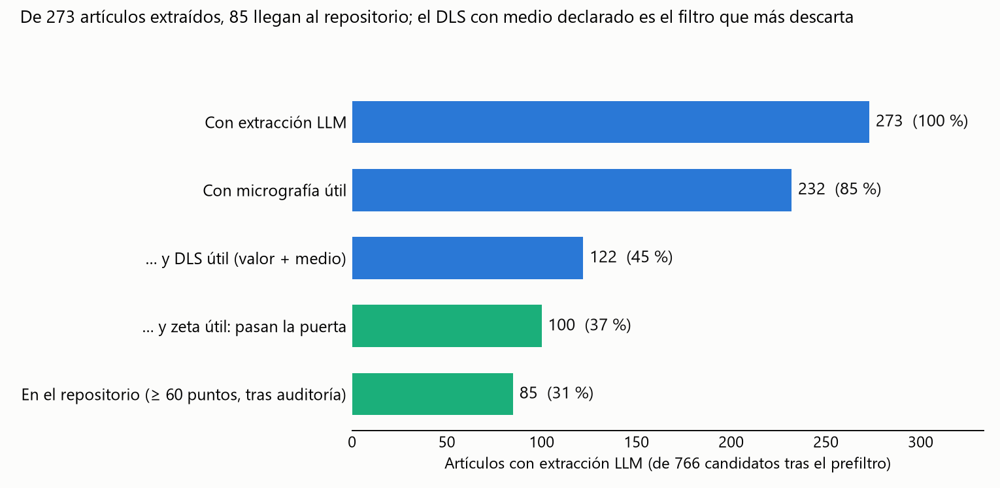
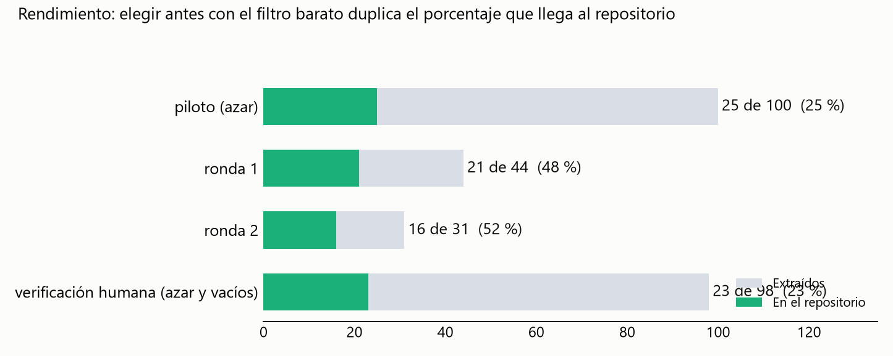
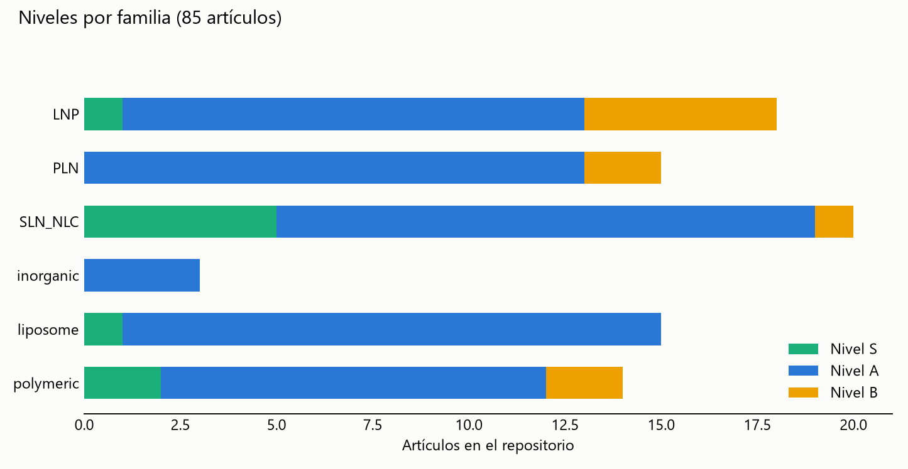

# Informe de curación de calidad (fase 2) — PROVISIONAL

> **Alcance de estas cifras:** 273 de los 766 candidatos leídos con modelos (100 al azar como piloto y 173 elegidos con un filtro barato por código), 85 artículos en el repositorio. La validación humana (Bryan y Carlos) **no está hecha**: todas las métricas son provisionales.

## 1. Embudo

- Procesados antes: 2.396 → sin AAV/virus/fuera de alcance → **766 candidatos** con señal de micrografía + DLS + zeta (prefiltro, `data/funnel.csv`).
- Con extracción LLM: **273**. Pasan la puerta estricta: **100**. En el repositorio (≥ 60 puntos y auditoría): **85**. 94 artículos se descartaron tras una sola lectura (no se gasta una segunda en ellos).
- Principales motivos de salida: DLS sin valor numerico con medio declarado (110); sin micrografia util (34); zeta sin valor numerico con medio o pH declarado (20); el nanoportador es una herramienta, no el objeto de estudio (5); micrografia y DLS/zeta son de muestras distintas (4); articulo retractado (2); desacuerdo no resuelto (2).

### Rendimiento por grupo

| Grupo | Extraídos | En el repositorio | % |
|---|---|---|---|
| piloto (azar) | 100 | 25 | 25 % |
| ronda 1 | 44 | 21 | 48 % |
| ronda 2 | 31 | 16 | 52 % |
| verificación humana (azar y vacíos) | 98 | 23 | 23 % |

El piloto se eligió al azar; las rondas 1 y 2 se eligieron con un filtro por código (tabla con tamaño y zeta, y medio declarado junto a DLS y zeta), por eso rinden más. No son comparables como una tasa de la población: la tasa del azar (piloto) es la que describe a los 766 candidatos.

## 2. Niveles y familias

Niveles: S 9, A 66, B 10. Por familia: LNP 18, PLN 15, SLN_NLC 20, inorganic 3, liposome 15, polymeric 14.
Micrografía del repositorio: TEM 51, SEM 24, cryo 10 artículos (proporción SEM 28 %); variantes registradas: TEM_negstain 88, SEM 52, TEM_dried_unstained 26, TEM_prep_not_declared 25, cryoTEM 20, HRTEM 2, STEM 1.

## 3. Técnicas, lotes y licencias

- Combinaciones de técnicas útiles (repositorio): `TEM+DLS+zeta` ×35; `SEM+DLS+zeta` ×13; `cryo+DLS+zeta` ×8; `TEM+DLS+zeta+FTIR` ×5; `TEM+DLS+zeta+FTIR+XRD` ×3; `TEM+DLS+zeta+DSC` ×3.
- Cobertura de lotes (formulaciones con DLS o zeta medidos por artículo): 1: 9, 2: 17, 3: 7, 4: 17, 5: 4, 6: 7, 8: 7, 9: 2, 10: 3, 11: 3, 12: 9 (clave: nº de formulaciones: artículos).
- Licencia (verificada contra Europe PMC, XML del artículo y página del editor cuando fue accesible): verde 66, amarillo 17, conflicto 2. Solo `verde` permite redistribuir figuras.
- DOI que no resuelven: 0.

## 4. Pistas secundarias y expansión

- **SAXS:** 32 mediciones de SAXS entre los artículos extraídos; 30 en 11 artículos del repositorio: **sigue sin haber muestra para evaluar un subconjunto de calidad**; con la prevalencia observada en el análisis previo (≈ 1 % de los artículos) se necesita una búsqueda dirigida de SAXS (no iniciada).
- **Inorgánicas:** el repositorio tiene 3 artículos de esta familia. Es el vacío más claro; se necesita una búsqueda dirigida (no iniciada).
- **Expansión dirigida (paso 7):** no iniciada. Las rondas 1 y 2 salieron de los artículos ya descargados; no se buscaron artículos nuevos.

## 5. Efecto del material suplementario

- Europe PMC marca material suplementario en el 60 % de los candidatos. El texto completo de Europe PMC **no incluye** ese material.
- 30 de 179 artículos con dos pasadas (17 %) tienen mediciones cuyos valores solo están en el suplemento o en figuras sin cifras: se marcan `valores_solo_en_SI` y **no cumplen la puerta**. No se descargó el suplemento; es una limitación clave y subestima el repositorio.

## 6. Cómo se trabajó y qué costó

- Filtro barato por código (0 tokens): tabla con tamaño y zeta, y medio declarado junto a DLS y zeta. En el piloto, ese criterio dejaba pasar a 19 de 23 artículos que luego aprobaron la puerta (83 %).
- Ronda 1: Haiku sobre un paquete corto (solo frases clave, pies de figura y tablas), luego Sonnet sobre el paquete completo en los que pasaban o casi. Haiku descartó por error a 8 de los 23 que Sonnet aprobó (recall 65 %), así que la ronda 2 fue directo a Sonnet y Haiku se usó como segunda lectura de los aprobados.
- Tokens de subagentes: 14.6 millones en total (haiku 5.0 M, sonnet 9.5 M). Por artículo leído: haiku ≈ 29 mil, sonnet ≈ 34 mil.
- Auditoría de Claude sobre lo que agregaron los agentes: 3 artículos excluidos a mano (`manual_review.csv`; Bryan y Carlos pueden revertirlos) y una regla nueva por código: la micrografía, el DLS y el zeta deben ser de una misma muestra.

## 7. Limitaciones y qué falta validar

- Falta la revisión humana de los 60 artículos (`hoja_revision_humana.csv`) y con ella los umbrales de precisión de la puerta (≥ 0,95), kappa de variante/grupo (≥ 0,80) y licencia (100 %). Mi auditoría no es independiente de los modelos.
- Las rondas 1 y 2 usaron una pasada sobre un extracto corto (Haiku) o una sola pasada completa (Sonnet) según el caso, y arbitraje solo de la puerta y los valores; los grupos de equivalencia salen de la pasada de Sonnet.
- Dos pasadas con modelos de la misma familia comparten sesgos; el arbitraje usó Sonnet (no un modelo más fuerte).
- Solo se procesaron los artículos ya descargados (2.396).
- Los DOI se comprobaron con la respuesta de `doi.org` (redirección), no con la página final del editor.
